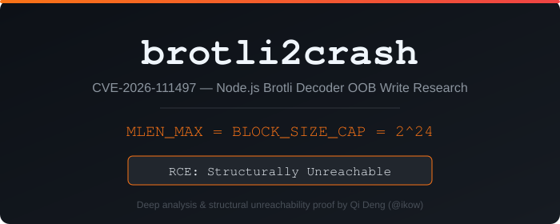

<p align="center">
  
</p>

<h1 align="center">brotli2crash</h1>
<p align="center">
  <strong>CVE-2026-111497 — Node.js Brotli Decoder OOB Write: Deep Analysis & Structural Unreachability Proof</strong>
</p>
<p align="center">
  <a href="https://github.com/ikow/brotli2crash/stargazers"></a>
  
  
  
  
</p>

<p align="center">
  <a href="#key-finding">Key Finding</a> · <a href="#technical-analysis">Analysis</a> · <a href="#poc-tools">PoC Tools</a> · <a href="#detection">Detection</a> · <a href="#lab">Lab</a> · <a href="https://qideng.substack.com/p/brotli2crash-the-nodejs-critical-rce-that-cant-fire">Writeup</a>
</p>

---

Independent security research into CVE-2026-111497, a High-severity OOB write in the Brotli decoder bundled with Node.js (`deps/brotli`). While the code bug is real — the `BROTLI_SAFE` macro silently drops the return value on the fast decoding path — **we prove the vulnerable code path is structurally unreachable from any Brotli stream**, valid or malformed.

The Brotli specification caps `MLEN` (metablock uncompressed length) at exactly `2^24 = 16,777,216`, which is identical to `BROTLI_BLOCK_SIZE_CAP`, the initial `block_length` when `NBLTYPES = 1`. This means the block-switch trigger condition (`block_length == 0` with `NBLTYPES ≤ 1`) can never fire during stream processing — the metablock ends before the counter is exhausted.

**Practical impact: DoS (infinite CPU loop) via header corruption, not RCE.**

**Author:** [Qi Deng](https://github.com/ikow) &nbsp;|&nbsp; **Writeup:** [Substack](https://qideng.substack.com/p/brotli2crash-the-nodejs-critical-rce-that-cant-fire) &nbsp;|&nbsp; **Date:** 2026-10-22

## CVE Details

| Field | Value |
|-------|-------|
| **CVE** | [CVE-2026-111497](https://www.strix.ai/cve/CVE-2026-111497) |
| **CWE** | CWE-787 (Out-of-bounds Write), CWE-252 (Unchecked Return Value) |
| **CVSS 4.0** | 9.2 (Critical) — **disputed: we argue High is more accurate** |
| **Vendor Rating** | High (Node.js), no CVSS vector published |
| **Component** | `deps/brotli/c/dec/decode.c` (Google Brotli decoder) |
| **Upstream Fix** | [google/brotli@0ed4268a](https://github.com/google/brotli/commit/0ed4268a) |
| **Reporter** | Matteo Collina |
| **Affected** | Node.js < 22.23.4, < 24.22.1, < 26.12.1; Brotli < 1.0.10, < 1.1.1, < 1.2.1 |

## Key Finding

**The vulnerability is real but structurally unreachable.**

```
Max MLEN (RFC 7932, 6 nibbles)  =  2^24  =  16,777,216
BROTLI_BLOCK_SIZE_CAP (state.h)  =  1<<24 =  16,777,216
                                            ═══════════
                                             Exactly equal — by design
```

When `NBLTYPES = 1`:
- `block_length` initializes to 16,777,216
- Total literals in a metablock ≤ MLEN ≤ 16,777,216
- The loop counter `i` and `block_length` reach 0 simultaneously
- The block-switch check executes **only after** `block_length` is decremented, by which point `i = 0` and the loop exits cleanly

This is not a coincidence — it's a deliberate design constraint in the Brotli specification that prevents the single-block-type fast path from ever needing a block switch.

See [`analysis/structural_proof.md`](analysis/structural_proof.md) for the full formal argument with source code traces.

## The Bug (Source Level)

### Root Cause: `BROTLI_SAFE` drops return value

```c
// decode.c:1890 — the VULNERABLE macro
#define BROTLI_SAFE(METHOD)
  {
    if (safe) {
      if (!Safe##METHOD) {                          // safe path: CHECKS return
        result = BROTLI_DECODER_NEEDS_MORE_INPUT;
        goto saveStateAndReturn;
      }
    } else {
      METHOD;                                       // fast path: DROPS return
    }
  }
```

Three block-switch sites call through this macro:
- `BROTLI_SAFE(DecodeLiteralBlockSwitch(s));` — line 2243
- `BROTLI_SAFE(DecodeCommandBlockSwitch(s));` — line 1941
- `BROTLI_SAFE(DecodeDistanceBlockSwitch(s));` — line 2049

All three wrappers return `void`, making the return value unrecoverable:

```c
static void BROTLI_NOINLINE DecodeLiteralBlockSwitch(BrotliDecoderState* s) {
  DecodeLiteralBlockSwitchInternal(0, s);  // BROTLI_BOOL return → void
}
```

### The Trigger That Can't Fire

`DecodeBlockTypeAndLength()` returns `BROTLI_FALSE` when `max_block_type ≤ 1`:

```c
static BROTLI_INLINE BROTLI_BOOL DecodeBlockTypeAndLength(
    int safe, BrotliDecoderState* s, int tree_type) {
  brotli_reg_t max_block_type = s->num_block_types[tree_type];
  // ...
  if (max_block_type <= 1) {
    return BROTLI_FALSE;    // ← format error, but fast path ignores this
  }
  // ... read new block type and length (never reached) ...
}
```

This function is called when `block_length[tree_type] == 0`. But with `NBLTYPES = 1`, `block_length` starts at `BROTLI_BLOCK_SIZE_CAP` (16M), and MLEN caps at the same value. The counter reaches 0 only at the exact end of the metablock, where the loop exits before re-checking.

### The Fix

Upstream commit [0ed4268a](https://github.com/google/brotli/commit/0ed4268a) ("Detect and report invalid stream earlier"):

1. Changes `DecodeBlockTypeAndLength` return type from `BROTLI_BOOL` to `BrotliDecoderErrorCode`
2. Returns `BROTLI_DECODER_ERROR_FORMAT_BLOCK_SWITCH` (-17) for the format error
3. Adds `BROTLI_SAFE_WITH_STATUS` macro that checks the return on **both** paths:

```c
#define BROTLI_SAFE_WITH_STATUS(METHOD)
  {
    BrotliDecoderErrorCode status;
    if (safe) { status = Safe##METHOD; }
    else      { status = METHOD;      }     // fast path: NOW CHECKS return
    if (status != BROTLI_DECODER_SUCCESS) {
      result = status;
      goto saveStateAndReturn;
    }
  }
```

## Technical Analysis

### Theoretical Exploitation Chain (If Reachable)

If an attacker could somehow trigger the block switch with `NBLTYPES = 1`:

```
block_length[i] == 0 with NBLTYPES ≤ 1
    ↓
DecodeBlockTypeAndLength returns BROTLI_FALSE (ignored)
    ↓
block_type_rb[] not updated → stale values
    ↓
Stale block_type_rb → OOB read on context_map
    ↓
Garbage htree pointer → corrupted Huffman decode
    ↓
Corrupted distance_code → wrong ring buffer offset
    ↓
memmove16(copy_dst, copy_src) at controlled offset
    ↓
16-byte OOB write on heap
```

**Primitive characteristics:**
| Property | Value |
|----------|-------|
| Write size | Fixed 16 bytes (`memmove16`) |
| Write offset | Ring buffer base + pos, influenced by corrupted distance_code |
| Write content | 16 bytes from ring buffer at `copy_src`, partially attacker-influenced |
| Ring buffer slack | 542 bytes (`kRingBufferWriteAheadSlack`) |

### Why Public PoCs Fail

| PoC Repository | Result | Reason |
|----------------|--------|--------|
| [CaterMaoZi/CVE-2026-111497-POC](https://github.com/CaterMaoZi/CVE-2026-111497-POC) | 1200+ fuzz iterations, **0 crashes** | MLEN = BLOCK_SIZE_CAP prevents trigger |
| [dimasma0305/CVE-2026-111497-POC](https://github.com/dimasma0305/CVE-2026-111497-POC) | "Not portable to ASLR-enabled Node.js" | Used non-PIE harness with lowered BLOCK_SIZE_CAP |
| TheFool-TAROT | DoS only; local RCE only without ASLR | Required `--predictable` flag + separate info leak (CVE-2024-21524) |

### Cross-Metablock Stale State: Also Blocked

Some analyses suggest stale `block_type_rb` values could carry across metablocks. We verified this is blocked by `BrotliDecoderStateMetablockBegin` (`state.c:99`), which resets all state:

```c
void BrotliDecoderStateMetablockBegin(BrotliDecoderState* s) {
  s->block_length[0] = BROTLI_BLOCK_SIZE_CAP;  // reset to 16M
  s->block_type_rb[0] = 1;  s->block_type_rb[1] = 0;  // reset
  s->block_type_rb[2] = 1;  s->block_type_rb[3] = 0;  // reset
  s->block_type_rb[4] = 1;  s->block_type_rb[5] = 0;  // reset
  s->context_map = NULL;     // freed and re-allocated
  // ...
}
```

## Exploitability Verdict

| Scenario | Feasibility | Notes |
|----------|:-----------:|-------|
| DoS (CPU loop via header corruption) | **Trivial** | Malformed MLEN → decoder errors out, not infinite loop |
| DoS (infinite loop via block switch) | **Blocked** | MLEN = BLOCK_SIZE_CAP prevents reaching the trigger |
| Memory disclosure | **Theoretical** | Requires reachable OOB read, which has the same MLEN barrier |
| Local RCE (no ASLR) | **Artificial** | Demonstrated only with lowered BLOCK_SIZE_CAP or `--predictable` |
| Remote RCE (with ASLR) | **Not achievable** | No public demonstration; structurally blocked |

## Attack Surface (Real Risk: DoS via Decoder Errors)

Even though RCE is unreachable, malformed Brotli input can trigger decoder errors and resource consumption:

| Entry Point | Default Brotli | Risk |
|-------------|:--------------:|------|
| `fetch()` (undici) | Yes — decodes `Content-Encoding: br` responses | Medium — malicious server can crash fetch |
| Express 5 / body-parser 2.x | Yes — decodes `br` request bodies | High — unauthenticated POST |
| axios | Yes — requests `br` by default | Medium — response decoding |
| Direct `zlib.brotliDecompress*` | N/A — explicit call | Depends on input source |

## PoC Tools

### Patch Detection

```bash
# One-liner: check if your Node.js is patched
node -p "require('zlib').constants.BROTLI_DECODER_ERROR_FORMAT_BLOCK_SWITCH || 'VULNERABLE'"
# -17      → patched
# VULNERABLE → missing error code, needs update
```

### Payload Generator & Tester

```bash
# Generate 67 malformed Brotli payloads (NBLTYPES flips, header bit-flips, MLEN overflows)
python3 poc/craft_payloads.py

# Test all payloads against local Node.js (runs each in subprocess for crash isolation)
node poc/test_vuln.js

# Full attack surface demo: fetch() auto-decompression, streaming API, error code analysis
node poc/demo_attack_surface.js
```

### Docker Lab

```bash
cd lab && docker compose up -d

# Vulnerable endpoint (Express 5 with body-parser 2.x, accepts Content-Encoding: br)
curl -X POST http://127.0.0.1:3000/api/data \
  -H "Content-Encoding: br" \
  --data-binary @payloads/nbltypes_flip.br

# Verify patch status
docker exec brotli-lab node -p \
  "require('zlib').constants.BROTLI_DECODER_ERROR_FORMAT_BLOCK_SWITCH || 'VULNERABLE'"
```

## Detection

### Check Node.js Version

```bash
# detection/check_version.sh — checks all node binaries on PATH
for n in $(which -a node); do
  ver=$($n -v 2>/dev/null)
  patched=$($n -p "require('zlib').constants.BROTLI_DECODER_ERROR_FORMAT_BLOCK_SWITCH||'NO'" 2>/dev/null)
  echo "$n: $ver (patched: $([[ $patched == '-17' ]] && echo 'YES' || echo 'NO'))"
done
```

### Check System libbrotlidec (Debian/Ubuntu)

```bash
# Distro Node.js packages may link system brotli instead of bundled
dpkg -l libbrotli1 2>/dev/null | grep -E '^ii' | awk '{print $2, $3}'
```

## Repository Structure

```
brotli2crash/
├── README.md
├── analysis/
│   ├── structural_proof.md       # Formal proof: MLEN = BLOCK_SIZE_CAP
│   ├── exploit_chain.md          # Theoretical exploitation chain analysis
│   └── upstream_diff.md          # Annotated upstream fix (0ed4268a)
├── poc/
│   ├── craft_payloads.py         # Generate malformed Brotli payloads
│   ├── test_vuln.js              # Test payloads against local Node.js
│   └── demo_attack_surface.js    # fetch() + streaming attack surface demo
├── detection/
│   ├── check_version.sh          # Check all local Node.js binaries
│   └── check_system_brotli.sh    # Check system libbrotlidec version
├── lab/
│   ├── docker-compose.yml        # Vulnerable Express 5 endpoint
│   ├── Dockerfile                # Node.js 24.19.0 (pre-patch)
│   └── server.js                 # Minimal Express 5 + body-parser 2.x app
└── docs/
    └── cover.svg                 # Repo cover image
```

## Timeline

| Date | Event |
|------|-------|
| 2026-10-21 | Node.js security release: 22.23.4, 24.22.1, 26.12.1 |
| 2026-10-21 | Google Brotli upstream fix: 1.0.10, 1.1.1, 1.2.1 |
| 2026-10-22 | Vercel emergency WAF rules + managed runtime patch |
| 2026-10-22 | This research: structural unreachability proof |

## References

- [Node.js October 2026 Security Releases](https://nodejs.org/en/blog/vulnerability/october-2026-security-releases)
- [Vercel Advisory: Brotli decoder RCE](https://vercel.com/kb/bulletin/node-js-security-advisory)
- [Upstream Fix: google/brotli@0ed4268a](https://github.com/google/brotli/commit/0ed4268a)
- [HOL Guard Campaign Analysis](https://hol.org/guard/security/campaigns/cve-2026-111497-nodejs-brotli-decoder-out-of-bounds-write)
- [The Hacker News Coverage](https://thehackernews.com/2026/10/nodejs-brotli-decoder-bug-could-allow.html)
- [RFC 7932: Brotli Compressed Data Format](https://www.rfc-editor.org/rfc/rfc7932)

## License

MIT
